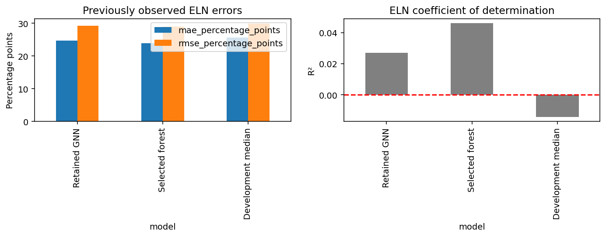

# Reaction Yield GNN

Predict percentage yield from input-only molecular graphs, reaction roles and temperature using PyTorch Geometric. Real ORD ELN experiments compare GINE graph regressors with fingerprint forests.

## Run

Run these commands from this repository's root.

Python 3.12 and a separate environment are recommended.

```powershell
python -m venv .venv
.\.venv\Scripts\Activate.ps1
python -m pip install -e ".[dev,notebooks]"
reaction-gnn fetch
reaction-gnn prepare
python -c "from reaction_gnn.quantities import prepare_quantitative; prepare_quantitative('data/external/az.parquet','data/processed/reactions-quantity-v2.json')"
python -m pytest -q
python train.py --output models/my-model
```

Root `train.py` fits the selected 47-epoch GNN and fingerprint forest on all 610 development records, saves training curves and checks checkpoint reload. It never evaluates the held-out records. Use fresh output directories. Predict with `reaction-gnn predict models/my-model/selected.pt YOUR_REACTION.json`.

Explicit observed ELN evaluation requires `python evaluation_scripts/evaluate.py --checkpoint-directory models/my-model --report docs/my-observed-eln.json --acknowledge-observed-eln`. Evaluation loads frozen weights and refuses existing reports. Weights and data are ignored; train locally before inference. On Linux/macOS activate `.venv/bin/activate`.

## Notebooks and results

Launch `python -m jupyter lab` from the activated environment.

- [Real ORD inputs and EDA](notebooks/01_real_ord_inputs_and_eda.ipynb)
- [Main graph model and training](notebooks/02_main_graph_model_and_training.ipynb): visible features, GINE pooling/training loop and actual training curves.
- [Evaluation and domain transfer](notebooks/03_evaluation_and_domain_transfer.ipynb)
- [Checkpoint deployment and transfer limits](notebooks/04_checkpoint_deployment_and_transfer_limits.ipynb): actual development replay, input contracts and target-spread diagnostics.

The retained GNN's retrospective ELN MAE is **24.642 percentage points**, versus forest **23.864**. On all **50,668 valid reactions** from the 50,688-row independent HTE source, GNN MAE is **23.637**, but R^2 is **-17.510**: broad chemistry generalization is not established.

See [Report.md](Report.md), [validation selection](Report.md#data-and-selection), [dataset provenance](docs/dataset-provenance.json) and [ORD license](docs/ORD-LICENSE.txt). The 740-row ELN cohort is small; grouping uses the principal reactant scaffold. The separate HTE source is narrow assay chemistry, with scaffold overlap. Products, measured outcomes, notes and source identifiers never enter predictors. Data, row predictions, weights and secrets stay ignored.


