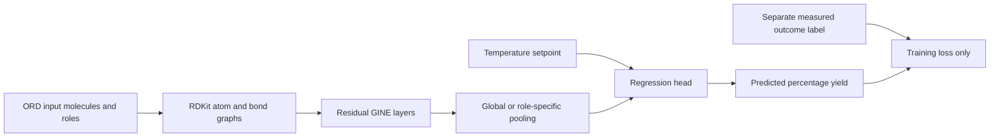

# Reaction Yield GNN

A trained PyTorch Geometric pipeline that predicts percentage reaction yield from **input-only molecular graphs**, reaction roles and temperature setpoint. It uses RDKit atom/bond features, GINE message passing and scaffold-aware validation on real Open Reaction Database (ORD) records.

The repository includes a controlled four-configuration, three-fold validation experiment and a stronger role-aware fingerprint forest baseline. A resumed quantity-aware experiment adds unit-safe reported amounts, concentration proxies and component-balanced graph pooling. Independent-source HTE transfer is evaluated only after model selection is frozen. Scores are experimental evidence, not a guarantee that the GNN generalizes or beats simpler models.

Current status: the original experiment is complete and a preregistered quantity-aware validation study is running. Historical results remain preserved. See the [quantity plan](docs/quantity-plan.json), [readiness checks](docs/quantity-preflight.md) and [aggregate report entrypoint](evaluation_scripts/report.py).

Measured selected-model ELN result: GNN MAE **25.20 percentage points**, versus development-median **25.62** and fingerprint forest **23.86**. The GNN has negative test R2 (**−0.024**) and does not demonstrate useful generalization over the stronger baseline. Its four-configuration, three-fold validation optimization is real, but this is not a highest-achievable-score claim.

## Isolated installation

```bash
python -m venv .venv
# Activate the environment for your platform, then:
python -m pip install -e ".[dev]"
reaction-gnn fetch
reaction-gnn prepare
python -m pytest -q
reaction-gnn optimize --epochs 60 --checkpoint models/optimized.pt --report docs/optimized-results.json
```

Python 3.12 is recommended. The executed environment was Python 3.14 with Torch 2.14 CPU/PyG 2.8.1/RDKit 2026.03.6, which issues upstream compatibility warnings. `ord-schema==0.9.3` constrains protobuf below version6; keep this repository in its own environment. Runtime dependencies are specified in `pyproject.toml`, and tests/packaging are checked in GitHub Actions.

The implemented download commands verify the exact SHA256 of their official ORD mirror objects. Raw Parquet, processed records and binary checkpoints are local under ignored `data/` and `models/`; they are never committed. Aggregate reports, public dataset provenance and group hash manifests are versioned. The initial dataset is 750 AstraZeneca ELN Buchwald–Hartwig reactions; 740 pass the explicit target/input validation checks. See [dataset provenance](docs/dataset-provenance.json), [ORD data license](docs/ORD-LICENSE.txt) and [methodology](docs/methodology.md).

## Input contract and model

Input molecular graphs are disjoint unions of reactant/reagent/solvent/catalyst graphs. Atom features encode atomic number, degree, charge, hydrogen count, aromaticity, ring membership, mass and reaction role. Directed bond edges encode bond order, conjugation, ring membership and aromaticity. Atom-map IDs are removed before canonicalization. Three residual GINE layers propagate bond-aware messages; optional role-specific pooling preserves separate substrate/reagent/solvent/catalyst summaries. The final head consumes pooled graphs and temperature/missingness and predicts a bounded 0–100 percent yield.

Only pre-reaction input components and temperature **setpoint** enter features. Products, measured yield, notes, analytical outcomes, recorded reaction time, experiment dates, reaction IDs and source names are excluded. A unit test changes products, labels and notes while asserting that inputs remain identical. The desired-product percentage yield is read separately as the label. Missing or multiple desired-product yields are rejected, including values outside 0–100. Zero yield is valid. Unspecified input structures are rejected except explicit no-catalyst/no-ligand sentinels.

The original model omits quantities and concentration; the resumed feature-version-2 study adds reported mole equivalents, volumes, limiting flags and a concentration proxy. Detailed addition sequence, pressure and procedures remain unmodeled; this limits attainable accuracy. Small or fragmented catalyst structures may carry useful chemistry that this compact model cannot fully represent.



## Evaluation and training

The largest-heavy-atom reactant defines a Murcko scaffold group, with canonical SMILES fallback for acyclic molecules and deterministic tie breaking. Seed42 selects563 train/47 validation/130 test rows (90/19/20 scaffold groups). Exact canonical input/condition clones and principal-scaffold overlap are explicitly rejected across splits. Smaller reactants and reagents may overlap and are not claimed held out. [Duplicate diagnostics](docs/feature-duplicate-diagnostics.json) also document repeated feature patterns within splits, which remain grouped and reduce effective sample diversity.

`optimize` treats610 train+validation rows as development data. It scores four fixed GNN configurations on three scaffold-disjoint folds, with max60 epochs and early stopping. It independently tunes the fixed forest min-leaf grid on the same folds. The selected GNN refits all development rows for the median validation best epoch count; the selected forest refits the same rows. Only then are final test predictions computed. MAE/RMSE are in **percentage points**, not fractions. The constant baseline is a development-only median. No final-test score drives configuration selection or further tuning.

An initial2-epoch exploratory smoke already reported an aggregate on the ELN test. That historical exposure is documented in the protocol; this cohort is **not described as a completely untouched test**. [Deferred source-transfer evaluation](docs/source-transfer-status.md) is implemented to use deterministic identifier-hash sampling from a different 50,688-reaction C–N HTE dataset after selection, with exact-input clones excluded. It has not been run and has no reported metrics. Its assay labels and narrow2 amine/4 aryl substrate design differ from the ELN data; it tests source transfer, not broad scaffold generalization.

[Optimization plan](docs/optimization-plan.md), [executed selected-model report](docs/optimized-results.json), [selection protocol](docs/selection-protocol.json), and [exploratory smoke](docs/smoke-results.json) preserve configurations, data hashes, fold metrics, refit epoch selection and limitations. The selected final model may remain weak; compare it with both baselines before using its estimates.

## Predict a proposed reaction

Create a local JSON file with the input structures and roles (0 reactant,1 reagent,2 solvent,3 catalyst):

```json
{
  "components": [
    {"smiles": "Brc1ccccc1", "role": 0},
    {"smiles": "CN", "role": 0},
    {"smiles": "CC(C)(C)[O-].[Na+]", "role": 1}
  ],
  "temperature_c": 100
}
```

```bash
reaction-gnn predict models/optimized.pt data/interim/proposed-reaction.json
```

This minimal example demonstrates the input interface; it is not a validated synthetic procedure. Checkpoints store state dictionaries plus architecture/feature versions and load with `weights_only=True`. No pickled estimator or arbitrary object execution is required for GNN inference.

## Repository layout

`src/reaction_gnn/` contains production fetching/protobuf parsing, graphs, training, optimization and inference. The requested `src/data`, `src/features`, `src/models`, `src/visualization` entry points delegate to those modules; repository paths live in `src/config.py`. `notebooks/` explores saved metrics only. Local data stages are `data/{external,raw,interim,processed}`. See [model artifact notes](models/README.md).

Code is an original MIT implementation. ORD data are CC BY-SA4.0; upstream ORD repository code is Apache2.0. Dataset authors and source publication remain attributed, and no raw or derived row-level chemistry dataset is redistributed here.

## Runnable notebook

The [complete real-data walkthrough](notebooks/end_to_end_walkthrough.ipynb) covers pinned acquisition/preparation, optional production training, recorded validation comparisons, plots and saved-model inference. Use this repository’s isolated environment plus Jupyter/matplotlib. All cells are initially unexecuted; optional actions are disabled by default and no observed test is automatically scored.
